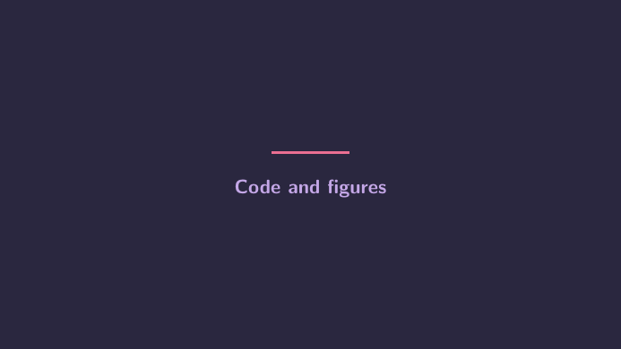
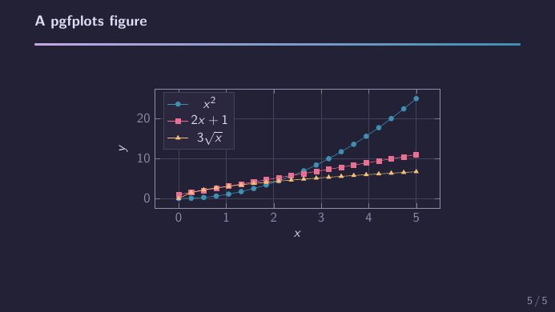

# Rosé Pine Moon for Beamer

A [Rosé Pine Moon](https://rosepinetheme.com/) theme for
[Beamer](https://ctan.org/pkg/beamer): a dark, low-contrast presentation theme
with a gradient accent rule, rounded callout boxes, a matching minted code
style and a pgfplots palette.

> All natural pine, faux fur and a bit of soho vibes for the classy minimalist.


| Callouts | Code | Plot |
|---|---|---|
|  |  |  |

## Install

### One-liner

```sh
git clone https://github.com/Derrekito/beamer-rose-pine-moon.git
cd beamer-rose-pine-moon
./install.sh
```

The installer copies the `.sty` files into
`$(kpsewhich -var-value TEXMFHOME)/tex/latex/beamer/RosePineMoon`.

- It is idempotent: files that are already identical are left alone.
- It never deletes anything. A differing existing file is backed up as
  `name.bak.<timestamp>` before being replaced.
- `texhash` is not needed for `TEXMFHOME`, but running it is harmless.

### Manual

Copy the `*.sty` files next to your `.tex` file (or into any directory on
`TEXINPUTS`).

### Code highlighting style (for minted)

The minted sub-theme asks Pygments for a style named `rosepinemoon`. minted 3
runs `latexminted`, which has to find that style as a Pygments plugin. Install
the style from this repo, together with a standalone `latexminted` so it is
picked up:

```sh
pip install latexminted .
```

(Use a virtualenv and put its `bin` first on `PATH` if you prefer not to
install globally.) Without the style, minted stops with
`Pygments style "rosepinemoon" was not found`.

## Usage

```latex
\documentclass[aspectratio=169]{beamer}
\usepackage{fontawesome5}      % icons in the callout boxes
\usetheme{RosePineMoon}
```

Build with shell escape (minted calls out to `latexminted`):

```sh
lualatex -shell-escape example.tex
```

`example.tex` is a short demo deck covering every feature below.

### Options

- `\usetheme[chrome]{RosePineMoon}` shows a minimal `n / total` frame number in
  the footline (never on the first page). The default is no footline.

### Callout boxes

`notebox`, `tip`, `warning`, `dangerbox` and `defbox`, each with an optional
title argument and a fontawesome5 icon:

```latex
\begin{notebox}[Heads up] ... \end{notebox}
\begin{tip} ... \end{tip}
\begin{warning} ... \end{warning}
\begin{dangerbox} ... \end{dangerbox}
\begin{defbox}[Term] ... \end{defbox}
```

The names carry a `box` suffix where `note`, `definition` or `danger` would
clash with existing beamer, amsthm or LaTeX definitions.

### Other helpers

- `\code{text}` inline code on a Surface background.
- `\rpmtoc` a "Where we are" table-of-contents frame highlighting the current
  section.
- `rpm` pgfplots style (`\begin{axis}[rpm]`) using the palette.
- The palette is available as colors: `Base`, `Surface`, `Overlay`, `Muted`,
  `Subtle`, `Text`, `Love`, `Gold`, `Rose`, `Pine`, `Foam`, `Iris`,
  `HighlightLow`, `HighlightMed`, `HighlightHigh`.

### Requirements

Loaded by the theme itself, so you do not need to load them:
`tikz`, `pgfplots` (compat 1.18), `tcolorbox` (with `most`, `skins`, `minted`),
`minted`, `fvextra` and `xcolor`.

You must load yourself:

- `fontawesome5`, only if you use the callout boxes (the icons come from it).

You must also have, outside LaTeX: Python with Pygments and `latexminted`
(see above), and compile with `-shell-escape`. Tested with LuaLaTeX; XeLaTeX
should also work.

## Sub-themes

`\usetheme{RosePineMoon}` loads all of these:

| File | Role |
|---|---|
| `beamerthemeRosePineMoon.sty` | Master theme, `chrome` option, loads the rest |
| `beamercolorthemeRosePineMoon.sty` | Palette and beamer colors |
| `beamerfontthemeRosePineMoon.sty` | Font roles |
| `beamerinnerthemeRosePineMoon.sty` | Bullets, blocks, TOC |
| `beamerouterthemeRosePineMoon.sty` | Title page, frame titles, section pages, footline |
| `beamertikzthemeRosePineMoon.sty` | TikZ defaults, pgfplots `rpm` style |
| `beamertcolorboxthemeRosePineMoon.sty` | Callout boxes |
| `beamermintedthemeRosePineMoon.sty` | minted settings and the `rosepinemoon` style hookup |

`rosepinemoon.py` is the Pygments style itself.

## Palette

Standard Rosé Pine Moon ([rose-pine/palette](https://github.com/rose-pine/palette)).

## License

[MIT](./LICENSE). Rosé Pine palette © the
[Rosé Pine](https://github.com/rose-pine) authors.
