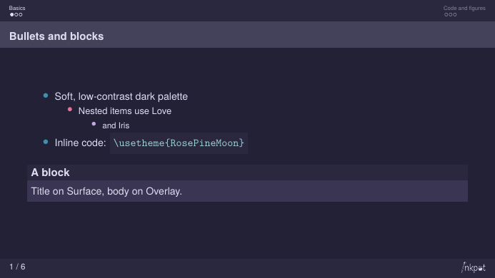
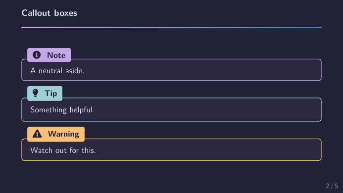

# Rosé Pine Moon for Beamer

A [Rosé Pine Moon](https://rosepinetheme.com/) theme for
[Beamer](https://ctan.org/pkg/beamer): a dark, low-contrast presentation theme
with rounded callout boxes, a matching minted code style and a pgfplots
palette. It comes in two variants that share one palette, one set of callouts
and one code style:

- **`RosePineMoon`** (full): a golden-spiral title page, a section navigation
  bar in the headline, a frame-title band, a frame-number footline and an
  optional logo.
- **`RosePineMoonSimple`**: a flat, centred title page, frame titles with a
  gradient accent rule, section divider pages and an optional frame number.

> All natural pine, faux fur and a bit of soho vibes for the classy minimalist.

## RosePineMoon (full)


| Layout | Callouts |
|---|---|
|  |  |

| Code | Plot |
|---|---|
|  |  |

## RosePineMoonSimple




## Install

### One-liner

```sh
git clone https://github.com/Derrekito/beamer-rose-pine-moon.git
cd beamer-rose-pine-moon
./install.sh
```

The installer copies the `.sty` files of both variants and the default logo
(`inkpot-logo.png`) into
`$(kpsewhich -var-value TEXMFHOME)/tex/latex/beamer/RosePineMoon`.

- It is idempotent: files that are already identical are left alone.
- It never deletes anything. A differing existing file is backed up as
  `name.bak.<timestamp>` before being replaced.
- `texhash` is not needed for `TEXMFHOME`, but running it is harmless.

### Manual

Copy the `*.sty` files (and `inkpot-logo.png`, for the full variant's default
logo) next to your `.tex` file, or into any directory on `TEXINPUTS`.

### Code highlighting style (for minted)

The minted sub-theme asks Pygments for a style named `rosepinemoon`. minted 3
runs `latexminted`, which has to find that style as a Pygments plugin. Install
the style from this repo, together with a standalone `latexminted` so it is
picked up:

```sh
pip install latexminted .
```

(Use a virtualenv and put its `bin` first on `PATH` if you prefer not to
install globally.) Without the style, minted stops with
`Pygments style "rosepinemoon" was not found`.

## Usage

```latex
\documentclass[aspectratio=169]{beamer}
\usepackage{fontawesome5}      % icons in the callout boxes
\usetheme{RosePineMoon}        % or \usetheme{RosePineMoonSimple}
```

Build with shell escape (minted calls out to `latexminted`):

```sh
latexmk example.tex          # full variant
latexmk example-simple.tex   # simple variant
```

Build with `latexmk`. The repo's `.latexmkrc` selects LuaLaTeX with
`-shell-escape`; for your own decks, copy it or run
`latexmk -lualatex -shell-escape deck.tex`. The title-page spiral and overlays
are placed relative to the page, which takes several passes, and latexmk
reruns until they settle. A single `lualatex` run leaves the spiral misplaced. `example.tex` and
`example-simple.tex` are short demo decks covering every feature below;
`example.tex` also sets TeX Gyre Heros as the sans font, which is optional.

### The spiral title page (full variant)

`\maketitle` (or `\titlepage` inside a `plain` frame) draws a golden-ratio
spiral behind the title: eleven squares, each 1/φ the size of the one before
and turned a quarter, filled in turn with `Base`, `HighlightLow`, `Overlay`,
`HighlightMed` and `HighlightHigh`, with a quarter-circle arc through each.
The large arc sweeps across the slide and the spiral winds into the lower
left. Everything is sized from `\paperheight`, so it keeps its shape at any
page size with a 16:9 ratio. The title, subtitle, author, date, institute and
logo sit centred over it. `\maketitle` gives the title page a frame of its own
with no headline, footline or frame number.

The arc colour is the beamer colour `title page spiral`:

```latex
\setbeamercolor{title page spiral}{fg=Muted}
```

### Logo (full variant)

The full variant puts a logo on the title page and a small one at the right of
the footline. It defaults to the bundled `inkpot-logo.png`; change or remove
it in the preamble:

```latex
\rpmlogo{my-logo.pdf}          % any file \includegraphics can read
\rpmlogo{}                     % no logo
\usetheme[nologo]{RosePineMoon} % no logo, as a theme option
```

A missing logo file gives a warning and is left out. Light artwork on a
transparent background reads best on the dark palette.

### Options

- `\usetheme[nologo]{RosePineMoon}` leaves out the logo (see above).
- `\usetheme[chrome]{RosePineMoonSimple}` shows a minimal `n / total` frame
  number in the footline (never on the first page). The simple variant's
  default is no footline. The full variant always has its footline.

### Callout boxes (both variants)

`notebox`, `tip`, `warning`, `dangerbox` and `defbox`, each with an optional
title argument and a fontawesome5 icon:

```latex
\begin{notebox}[Heads up] ... \end{notebox}
\begin{tip} ... \end{tip}
\begin{warning} ... \end{warning}
\begin{dangerbox} ... \end{dangerbox}
\begin{defbox}[Term] ... \end{defbox}
```

The names carry a `box` suffix where `note`, `definition` or `danger` would
clash with existing beamer, amsthm or LaTeX definitions.

### Other helpers

- `\code{text}` inline code on a Surface background.
- `\rpmtoc` (simple variant) a "Where we are" table-of-contents frame
  highlighting the current section. The full variant numbers its table of
  contents and shades the other sections instead.
- `rpm` pgfplots style (`\begin{axis}[rpm]`) using the palette.
- The palette is available as colors: `Base`, `Surface`, `Overlay`, `Muted`,
  `Subtle`, `Text`, `Love`, `Gold`, `Rose`, `Pine`, `Foam`, `Iris`,
  `HighlightLow`, `HighlightMed`, `HighlightHigh`.

### Requirements

Loaded by the theme itself, so you do not need to load them:
`tikz`, `pgfplots` (compat 1.18), `tcolorbox` (with `most`, `skins`, `minted`),
`minted`, `fvextra` and `xcolor`.

You must load yourself:

- `fontawesome5`, only if you use the callout boxes (the icons come from it).

You must also have, outside LaTeX: Python with Pygments and `latexminted`
(see above), and compile with `-shell-escape`. Tested with LuaLaTeX; XeLaTeX
should also work.

## Files

Shared by both variants, so they cannot drift apart:

| File | Role |
|---|---|
| `beamercolorthemeRosePineMoon.sty` | Palette and beamer colors |
| `beamerfontthemeRosePineMoon.sty` | Font roles |
| `beamertikzthemeRosePineMoon.sty` | TikZ defaults, pgfplots `rpm` style |
| `beamertcolorboxthemeRosePineMoon.sty` | Callout boxes |
| `beamermintedthemeRosePineMoon.sty` | minted settings and the `rosepinemoon` style hookup |
| `rosepinemoon.py`, `pyproject.toml` | The `rosepinemoon` Pygments style |

Full variant, `\usetheme{RosePineMoon}`:

| File | Role |
|---|---|
| `beamerthemeRosePineMoon.sty` | Master theme, `nologo` option, loads the rest |
| `beamerouterthemeRosePineMoon.sty` | Spiral title page, headline, frame title band, footline, `\rpmlogo` |
| `beamerinnerthemeRosePineMoon.sty` | Circle bullets, numbered table of contents, captions |
| `inkpot-logo.png` | Default logo |

Simple variant, `\usetheme{RosePineMoonSimple}`:

| File | Role |
|---|---|
| `beamerthemeRosePineMoonSimple.sty` | Master theme, `chrome` option, loads the rest |
| `beamerouterthemeRosePineMoonSimple.sty` | Title page, frame titles, section pages, footline |
| `beamerinnerthemeRosePineMoonSimple.sty` | Bullets, rounded blocks, `\rpmtoc` |

## Palette

Standard Rosé Pine Moon ([rose-pine/palette](https://github.com/rose-pine/palette)).

## License

[MIT](./LICENSE). Rosé Pine palette © the
[Rosé Pine](https://github.com/rose-pine) authors.

Logo: Inkpot (https://inkpot.md)
